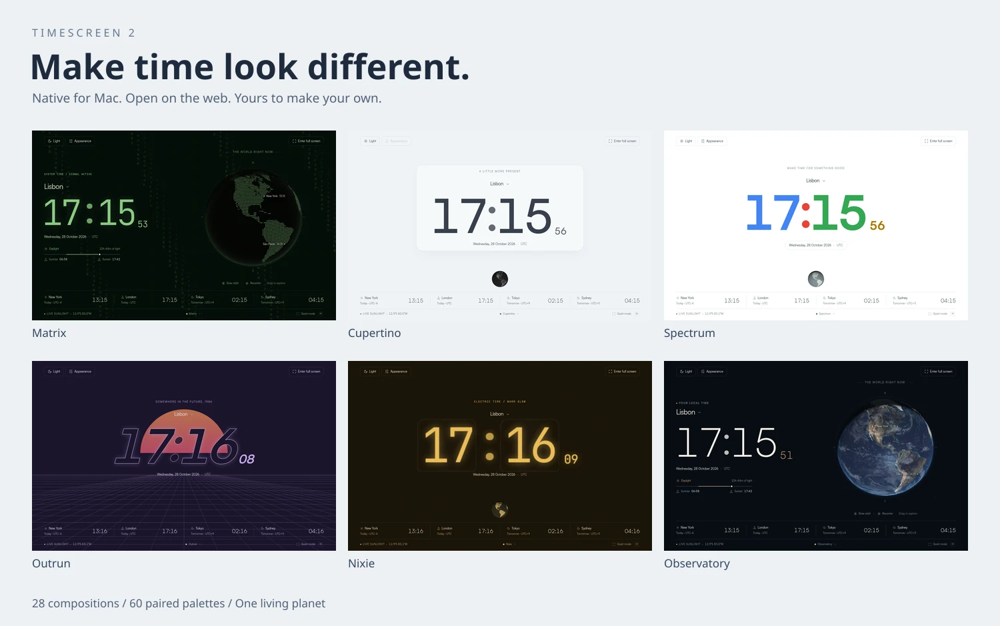
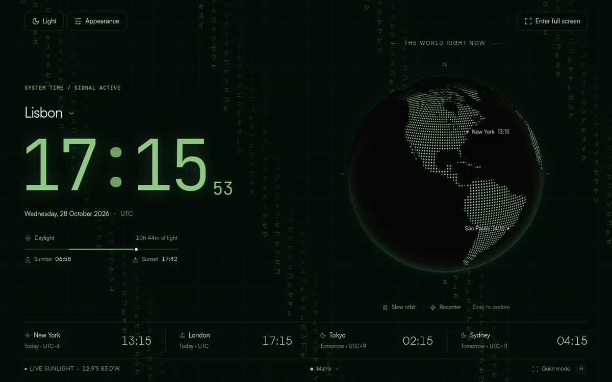
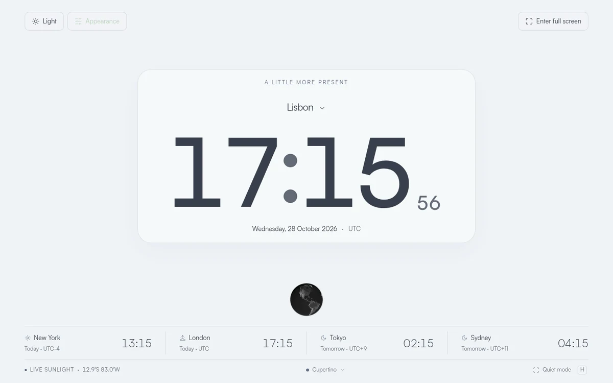
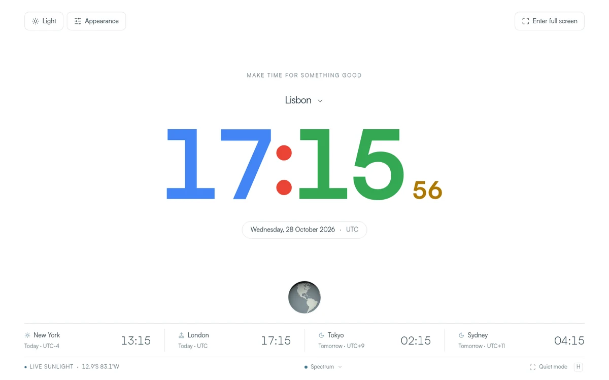
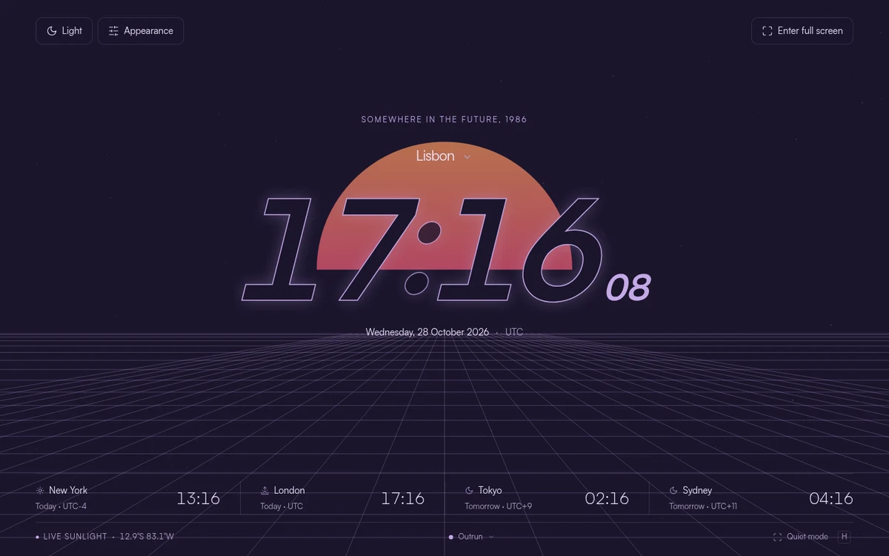
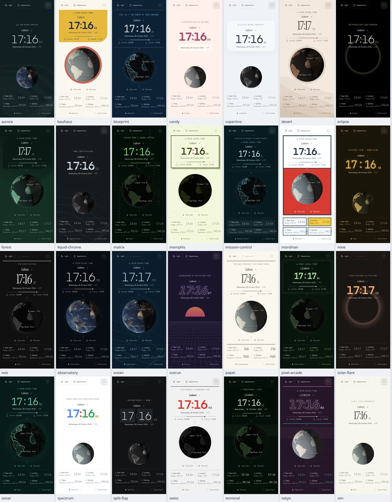

# Timescreen

<div align="center">



<h3>A spare screen, put to good use.</h3>

28 styles. 60 colour palettes. One planet.<br>
A native Swift macOS app and a fullscreen HTML5 clock, sharing the same living display.

<br>

[Download for Mac](https://github.com/paulfxyz/timescreen/releases/latest) · [Open the web clock](https://time.paulfleury.com) · [Installation](INSTALL.md) · [All releases](https://github.com/paulfxyz/timescreen/releases)

[](https://github.com/paulfxyz/timescreen/releases/latest)
[](INSTALL.md)
[](macos/)
[](macos/Sources/)
[](#a-style-for-every-mood)
[](public/themes.js)
[](LICENSE)
[](https://github.com/paulfxyz/timescreen/actions/workflows/ci.yml)
[](https://github.com/paulfxyz/timescreen/actions/workflows/macos.yml)

</div>

## Why it exists

I have a three-screen setup, and one of my extra displays is vertical. When I am not using it, I want something calmer than another feed: the time, a slowly turning Earth, and a little sunlight.

Timescreen started as a single fullscreen page. Version 2 gives it a native home on the Mac and a much more expressive wardrobe, from quiet typography to falling code and neon grids.

## Made for your Mac

Download the universal DMG, drag Timescreen into Applications, and open it. No account, subscription, Node installation, or browser extension is needed.

- **Native where it matters:** a Swift/AppKit application with proper Mac menus, fullscreen Spaces, window restoration and Dock/Spotlight access.
- **One click away:** a menu-bar launcher stays available when the window is closed; optional login launch is off by default.
- **Your display, your rules:** move to another monitor, float above other windows, open in fullscreen, or keep the display awake while the clock is visible.
- **Live by default, offline when needed:** automatically loads `https://time.paulfleury.com`; a complete bundled copy takes over if the website is unavailable or older than the app.
- **A remembered setup:** style, colour, city, picture controls and window position survive relaunch.
- **Updates that stay in the app:** check now, or opt into automatic download/install. A pinned Ed25519 key verifies both the update feed and the application archive.
- **More reliable window memory:** remember position, size and physical display, recover safely when a display disappears, or reset the saved placement in Settings.
- **No Electron:** the clock runs in Apple's WKWebView. There is no bundled Chromium runtime, local web server or JavaScript-to-shell execution.

> **First launch:** this open-source build is ad-hoc signed, not Apple-notarized. If macOS blocks it, attempt to open it, then use System Settings → Privacy & Security → Open Anyway only if you trust the official download. See [Apple's guidance](https://support.apple.com/en-us/102445) and [our installation guide](INSTALL.md); never disable Gatekeeper globally.

### New in 2.1.0

Timescreen → Settings now groups **Updates**, **Startup and window**, and **Display and access**. Automatic checks run every six hours by default; automatic downloading/installing and launch at login are optional, while window position/size/display memory is on by default.

Version 2.0.0 users install the 2.1.0 DMG once to gain the updater. After that, Check for Updates can download, install and relaunch newer releases without another browser-based download; automatic installs finish when the application quits.

## A style for every mood

These are compositions, not just recolours. Clock faces, layout, Earth treatment, graphics and restrained ambient effects change together; all 60 paired colour palettes remain independently selectable.

| Mood | Styles |
| --- | --- |
| Minimal | Observatory, Cupertino, Swiss, Zen |
| Digital | Matrix, Terminal, Tokyo neon, Blueprint, Sonar, Mission control, Liquid chrome |
| Retro | Split-flap, Outrun, Nixie, Pixel arcade |
| Playful | Spectrum, Bauhaus, Candy, Memphis, Mondrian |
| Atmospheric | Eclipse, Aurora, Deep ocean, Forest, Desert, Solar flare |
| Editorial | Noir, Sunday paper |

<table>
<tr>
<td width="50%"><br>Matrix · follow the time</td>
<td width="50%"><br>Cupertino · a little more present</td>
</tr>
<tr>
<td width="50%"><br>Spectrum · time in primary colours</td>
<td width="50%"><br>Outrun · somewhere in the future, 1986</td>
</tr>
</table>

[See all 28 actual displays](.github/img/styles-contact-sheet.webp). Cupertino and Spectrum are independent design tributes, not Apple or Google products; no proprietary logos or fonts are included.

The gallery combines search and category filters, provides a one-click shuffle, and supports previous/next style shortcuts. Ambient effects respect Reduce Motion and pause in hidden tabs; the globe's rendering rate is capped rather than racing a high-refresh monitor.

## Still a very good clock

- **A real-time Earth:** calculated sunlight, an accurate day/night boundary, optional night lights, and city labels.
- **IANA time zones:** city search, device-zone detection, daylight-saving-aware clocks, four world clocks, and sunrise/sunset estimates.
- **Room-friendly controls:** 12/24-hour time, optional seconds, quiet mode, eight background patterns and six Earth finishes.
- **Picture adjustment:** brightness, contrast, saturation and warmth, plus Standard, Cinema, Vivid and Night presets; settings stay readable even at minimum display brightness.
- **Portrait to panoramic:** automatic layouts for vertical monitors, desktops, phones and 10:3 displays, with manual layout overrides.
- **Portable setups:** local persistence, bookmarkable fragments and copy/restore codes; previous `time:v2:` and `solstice:v1:` setups remain compatible.

<div align="center">

</div>

## The web stays first-class

[time.paulfleury.com](https://time.paulfleury.com) uses the same HTML5 interface as the Mac app. Open it, choose a style, press `F`, and move the window to your spare screen.

After a complete online visit, the service worker caches the clock for offline use. The Mac app goes further by including its full offline copy at installation, so it does not require a successful first visit.

Browser fullscreen, clipboard and screen-wake access depend on the browser's permissions. Restricted or embedded environments provide recoverable alternatives rather than pretending those permissions were granted.

## Keyboard shortcuts

| Action | Web / clock focus | Native Mac menu |
| --- | --- | --- |
| Fullscreen | `F` | `Control` + `Command` + `F` |
| Appearance | `T` | `Command` + `T` |
| Picture controls | `B` | `Command` + `B` |
| Quiet mode | `H` | `Command` + `K` |
| Previous / next style | `[` / `]` | `Command` + `[` / `]` |
| Light / dark | `L` | Light controls |
| Pause / resume orbit | `Space` | Clock control |
| Restore controls / close dialog | `Escape` | `Escape` |
| Settings | Appearance → Display | `Command` + `,` |
| Reopen window | Browser tab | `Command` + `0` or menu-bar launcher |

Arrow keys rotate a focused globe; `+` / `-` zoom, and `0` recentres it. Mac menu shortcuts keep working without needing to focus the webpage first.

## Build it yourself

Node.js 22+ builds the web assets. Xcode Command Line Tools on macOS are needed only for the native app.

```sh
git clone https://github.com/paulfxyz/timescreen.git
cd timescreen
npm ci
npm run build
npm test
npm start
# Open http://localhost:3000
```

On a Mac, after the web build:

```sh
npm run build:mac
npm run build:dmg
# build/Timescreen.app
# build/Timescreen-2.1.0-macOS-universal.dmg
```

The build verifies pinned upstream hashes for the separately licensed Earth textures and Satoshi font. JetBrains Mono and Instrument Serif are included under the SIL Open Font License; see [asset notices](docs/ASSETS.md).

### Project map

```text
public/                 Static HTML5 clock, styles, effects, Earth, offline cache
macos/Sources/          Native window, menus, display controls, trusted bridge
macos/Tests/            Native origin, path and setup-policy checks
macos/scripts/          Universal compilation and drag-to-install DMG packaging
tests/                 Scene, picture, solar and time-zone unit tests
tools/qa-web.mjs        Reproducible browser interaction checks
.github/workflows/     Web quality, native build, release and optional FTPS deploy
```

### Architecture

```text
Swift / AppKit
  ├─ native menus, fullscreen, displays, login preference, display sleep
  ├─ saved window + setup + physical display identity
  ├─ Sparkle updater: pinned signed feed + signed update archive
  └─ WKWebView
       ├─ https://time.paulfleury.com        live, automatically on launch
       └─ timescreen://app/index.html       bundled offline fallback
            └─ HTML + CSS + ES modules + WebGL / geographic Canvas fallback
```

The bridge accepts only a small set of messages from the trusted main-frame origin. Bundled resource paths reject traversal, external web links open in the default browser, and untrusted URL schemes are blocked.

## Verification and boundaries

The release pipeline builds both architectures, checks the ad-hoc signature, launches a real macOS WKWebView, exercises native fullscreen and saved setup, and mounts and verifies the finished DMG. Browser QA checks the actual controls, every scene at desktop and mobile widths, and offline/fallback behaviour; the exact tested scope lives in [QA.md](QA.md).

Physical multi-monitor arrangements, managed-Mac Gatekeeper policy and login-item approval still depend on the user's environment. This is a display app, not a macOS `.saver` plugin, wallpaper engine, alarm, or stopwatch.

## Privacy, licensing and credits

No analytics, account, cloud settings database, location permission, microphone or camera access is required. The live site and enabled update checks make ordinary HTTPS requests; the clock, saved settings and solar calculations run locally, and the updater sends no system profile.

Original application code is [MIT-licensed](LICENSE). Third-party imagery, fonts and icons keep their own licences; [asset attribution](docs/ASSETS.md) and [security notes](SECURITY.md) explain the details.

Created by [Paul Fleury](https://paulfleury.com), with Perplexity Computer. Contributions that preserve the quiet experience are welcome; start with [CONTRIBUTING.md](CONTRIBUTING.md).
